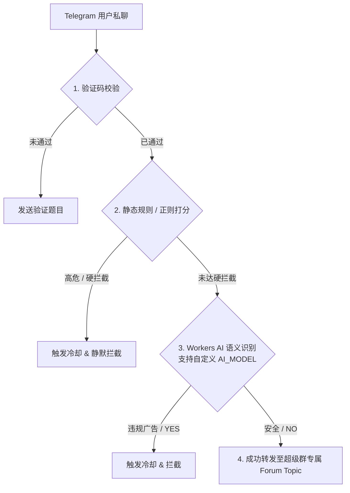

# 🛡️ Shaw Telegram Private Chat <-> Supergroup Topic Bot

基于 **Cloudflare Workers** 构建的 Telegram 私聊与超级群论坛话题（Forum Topics）双向转发机器人。支持**数学/常识安全验证**、**多级防刷限频**、**静态正则过滤** 以及基于 **Cloudflare Workers AI**（支持通过环境变量动态配置与自由切换模型）的深度智能语义风控。

---

## ✨ 核心功能

1. **双向无缝转发**：
   - 用户私聊发送消息（文字、图片、视频、文件、相册媒体组），机器人自动在超级群中为该用户创建并绑定一个独立的 ** Topic（话题）** 进行转发。
   - 管理员在超级群的对应话题内回复消息，即可实时转发回该用户的私聊中。
2. **多层智能防骚扰与反垃圾（Anti-Spam）**：
   - 🛡️ **前置安全验证**：新用户首次使用需通过动态数学题或常识题验证，防止机器人生硬刷屏。
   - ⚡ **静态规则拦截（第一道防线）**：支持高危链接、`@` 提及引流、转发私聊消息硬拦截、高频重复文本刷屏检测。
   - 🤖 **Workers AI 智能语义兜底（第二道防线）**：集成 Cloudflare Workers AI，对绕过静态规则的隐蔽变体、黑产引流、买卖账号及诈骗话术进行深度语义理解。支持通过 `AI_MODEL` 变量灵活切换不同的 CF 免费模型。
3. **精简静默的通知策略**：
   - 🚫 **杜绝通用频道刷屏**：所有的拦截日志与违规原文不会发送到通用群主页或频道。
   - 🎯 **话题内精简提示**：仅在已有对话的话题内，以一行干净的 `⚠️ [系统提示]` 告知管理员拦截动作与原因，不展示冗长的垃圾原文，保持群聊界面整洁。
4. **完善的管理员指令系统**：
   - 支持在群内直接管理冷却用户、查看冷却列表、手动封禁/解封、设置信任白名单以及清理用户状态数据。

---

## 🏗️ 智能风控工作流



---

## 🚀 在 Cloudflare Workers 上的部署指南

本机器人采用单文件无状态设计，可直接通过 Cloudflare Dashboard 快速部署。

### 第一步：部署代码
1. **创建 Workers**：在 Cloudflare 仪表盘中创建一个新的 Worker；将当前项目代码完整复制到 Cloudflare Workers 的 **Quick Edit** 在线编辑器中部署。
2. **绑定 KV 命名空间**：
   - 创建一个 KV 命名空间（例如命名为 `PM`）。
   - 在 Worker 的 **Settings -> Variables -> KV Namespace Bindings** 中绑定变量名 `PM`。
3. **绑定 Workers AI**：
   - 在 Worker 的 **Settings -> Variables -> Workers AI** 中添加绑定，变量名保持默认 `AI`。

### 第二步：配置环境变量与 Secrets
在 Worker 的 **Settings -> Variables and Secrets** 中添加以下配置：

| 变量/密钥类型 | 名称 | 示例值 / 说明 |
| :--- | :--- | :--- |
| **Secret (加密)** | `BOT_TOKEN` | Telegram Bot API Token（通过 `@BotFather` 获取） |
| **Variable (明文)** | `SUPERGROUP_ID` | 接收转发的超级群 ID（**注意：超级群必须开启 话题 功能**） |
| **Variable (明文)** | `AI_MODEL` | *(可选)* 自定义 AI 模型名称。留空则默认使用 `@cf/qwen/qwen3.8-27b`，也支持切换为 `@cf/meta/llama-3-8b-instruct` 等其他 CF 免费模型。 |

### 第三步：激活 Webhook

部署完成后访问（替换参数）：

```text
https://api.telegram.org/bot<你的BOT_TOKEN>/setWebhook?url=https://<你的Worker域名>&allowed_updates=["message","callback_query"]
```

检查状态：

```bash
curl "https://api.telegram.org/bot<你的BOT_TOKEN>/getWebhookInfo"
```

测试机器人：

```
前往 Telegram 给机器人发送 `/start` 即可开始测试。
```
---


## 🛠️ 超级群管理员命令

在超级群话题内或主群发送以下命令（仅限群管理员）：

* `/help`：查看管理员帮助菜单
* `/cl` 或 `/cool`：查看当前处于冷却中的用户列表（带有一键解封按钮）
* `/uf <uid>`：解除指定 UID 用户的冷却限制
* `/trust <uid>`：将指定用户加入信任列表（绕过部分风控校验）
* `/untrust <uid>`：取消指定用户的信任状态
* `/clean <uid>`：清理指定 UID 的所有关联状态与数据

---

